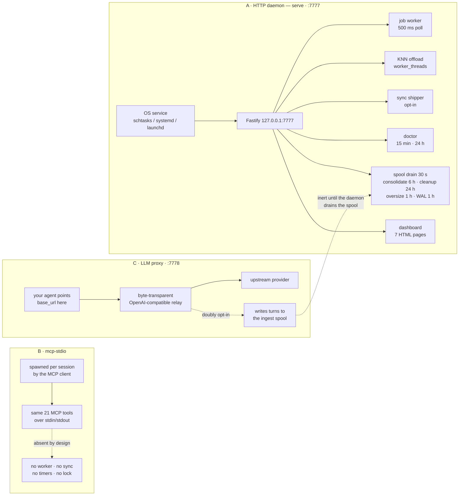
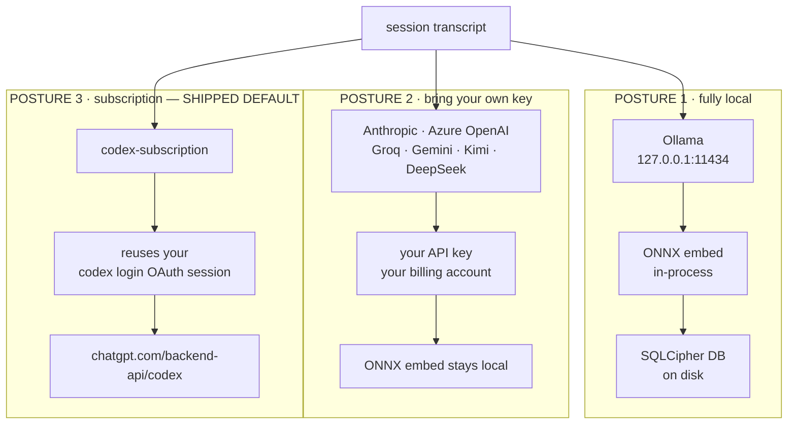
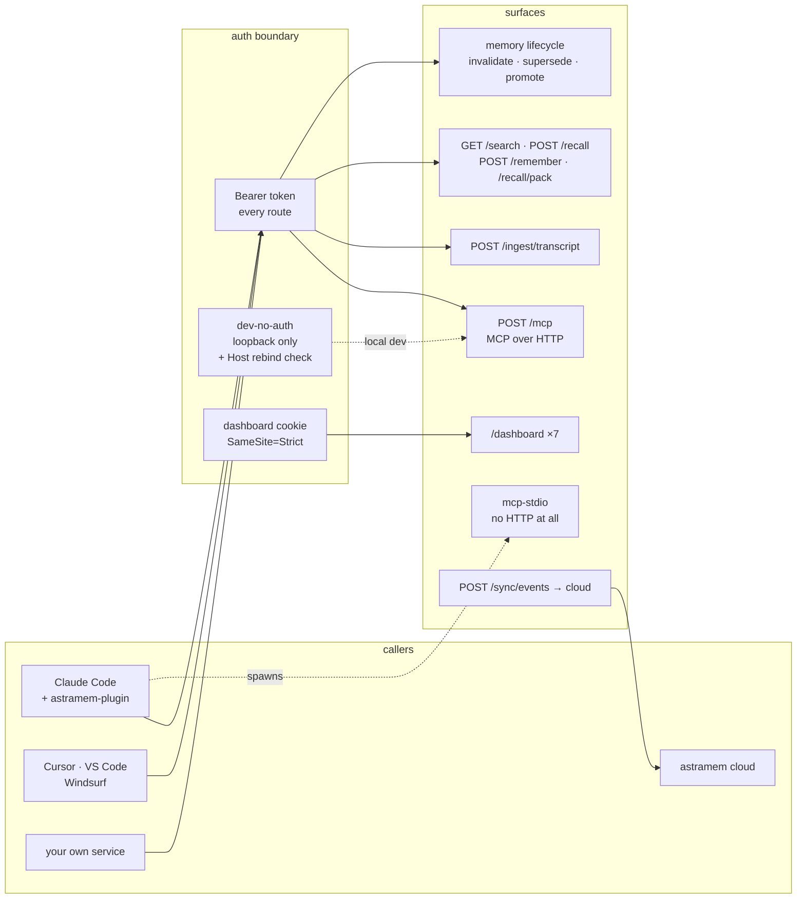

# astramem-local — Architecture Sheets

> Drawn from source at **v0.22.0, schema 63** · 2026-08-04.
> Every stage name, default, constant and endpoint below was read out of the repository, not the
> docs. Where code and existing docs disagree, this file follows the code.
> Interactive version: see the published artifact, or open `astramem-architecture.html`.

Five drawings of how astramem-local actually works — where it runs, whose keys it uses, what
happens to a transcript, how you plug in — plus a candid list of what is not customer-ready.

---

## Sheet 01 — Three ways to run it

> **Customer asks:** *Do I have to install a service? What if I just want to try it?*

The same tool ships in three runtime shapes. They are not tiers — they are different trade-offs
between capability and footprint. Only the daemon captures and distils in the background; the
other two are deliberately lighter.

| Capability | Daemon | mcp-stdio | Proxy |
|---|---|---|---|
| MCP tools | yes | yes | — |
| Transcript capture | yes | no | tee only |
| Background distill | yes | no | — |
| Cloud sync | yes | no | — |
| Dashboard | yes | no | — |
| Needs a service install | yes | **no** | no |

**Worth knowing.** The proxy is a byte-transparent relay on `:7778` — its separation from capture
is enforced by its own tests. When capture is enabled (doubly opt-in) it writes turns **straight
to the ingest spool on disk**, not over HTTP to the daemon. So the proxy runs happily with no
daemon at all; the captures simply sit in the spool, inert, until a daemon starts and its
30-second drain picks them up.

---

## Sheet 02 — Whose keys, and what leaves the machine

> **Customer asks:** *Does my source code get sent to somebody's cloud?*

Memories, embeddings and the database never leave the workstation unless you explicitly pair
cloud sync. What may leave is **transcript text sent to an LLM for extraction** — and that depends
entirely on which provider you pick.

| Posture | Auth | Cost control | Field status |
|---|---|---|---|
| **Fully local** — ollama + onnx | none | free, GPU time only | documented + in use |
| **BYO key** — Anthropic, Azure | API key in `secrets.env` or env | your vendor bill | wired |
| **BYO preset** — Groq, Gemini, Kimi, DeepSeek | API key per preset | your vendor bill | ⚠️ not field-tested |
| **Subscription** — `codex-subscription` *(default)* | `codex login` OAuth session | ChatGPT plan quota | ⚠️ quota cliff |

### 🔴 The money box does not cover the default

`budget.daily_usd` defaults to $10 — but every shipped provider reports `usage.usd: 0`, so the cap
**never sees codex spend**. Cost control for the default provider is your ChatGPT plan quota and
nothing else.

Not theoretical: a quota exhaustion on 2026-07-31 poisoned 198 distill jobs and silently dropped
~875 memories until they were replayed on 2026-08-04. The product's own doctor check
(`budget-cap-codex-blind`) says this out loud.

### 🟠 Read before demoing the default

`codex-subscription` transits `chatgpt.com/backend-api/codex` — an unofficial ChatGPT product
surface, not the public OpenAI API — by reusing the Codex CLI's OAuth session. The provider's own
source comment flags possible ToS risk to the user's OpenAI account. A customer also cannot use it
without a paid ChatGPT plan and a completed `codex login`.

---

## Sheet 03 — The distillation pipeline

> **Customer asks:** *What actually happens to my transcript?*

This is the working drawing — the one to plan improvements against. Eight numbered stages, plus
five unnumbered sub-stages woven between them. The numbering is real: stages execute in this order
and each depends on the last.

```mermaid
flowchart TB
  IN["POST /ingest/transcript<br/>v1.0 or legacy v0.0 envelope<br/>Idempotency-Key = SHA-256 body"] --> SP["spool → jobs table"]
  SP --> S1

  S1["1 · cleanup<br/>dedupe repeats, collapse blanks"] --> S2
  S2["2 · normalize<br/>paths, timestamps, agent aliases"] --> S3
  S3["3 · chunk<br/>turn-aware · 3200 chars default<br/>clamp 400 – 16000"] --> GK

  GK{"gatekeeper<br/>LLM pre-filter"} -->|"off by default"| S4
  S4["4 · compact<br/>LLM · budget-gated"] --> S5
  S5["5 · extract<br/>LLM JSON-mode · Zod-validated<br/>atoms + entities + relations"] --> S5B

  S5B{"5b · extract-specifics<br/>pass B sweeper"} -->|"DEFAULT ON<br/>skips chunks with 8+ atoms"| MG
  MG["dual-pass merge<br/>substring dedup, pass A wins ties"] --> S6
  S6["6 · reduce<br/>merge by content hash<br/>keep highest importance"] --> LA
  LA["link-atoms<br/>cross-atom candidates"] --> GD
  GD["ground-dates<br/>narrow LLM · never throws"] --> S7
  S7["7 · memory-normalize<br/>entity dict, final hash, type hints"] --> S8

  subgraph S8["8 · embed-index — three phases"]
    direction TB
    P1["A · filter<br/>erased-hash → durability gate → evidence gate"]
    P2["B · atom triage<br/>LLM type repair · off by default"]
    P3["C · persist<br/>embed → memories → memories_vec<br/>entities → entity_relations → links"]
    P1 --> P2 --> P3
  end

  S8 --> OUT["typed memories<br/>decision · fact · lesson · command<br/>todo · note · event"]
```

### Where the money and the losses are

| Stage | LLM | Can drop content | Default |
|---|---|---|---|
| gatekeeper | yes | whole chunks | off |
| 4 · compact | yes | — | on, gated |
| 5 · extract | yes | hallucinated entities | on |
| 5b · pass B | yes | — | **on** |
| 6 · reduce | no | hash duplicates | on |
| 8A · durability gate | no | low-quality atoms | lenient |
| 8A · evidence gate | no | pass-B atoms | off |
| 8B · atom triage | yes | retypes atoms | off |

### Failure behaviour

- **3 attempts, then poison.** Transient errors back off exponentially to 60 s; deterministic
  errors poison immediately.
- **Budget exceeded pauses, it does not fail.** A paused job keeps its attempt count —
  deliberately, so a cap breach cannot burn a job toward poison.
- **Requeue does not reset attempts.** A poisoned job gets exactly one more try. Replaying a large
  backlog while the provider is still failing burns every one of them. Batch the replay.
- **Wide fail-open.** Vector-index failures enqueue a re-embed rather than sinking the batch;
  entity, relation and link write failures skip the item and increment a counter.

### Retrieval side

Search fuses BM25 + cosine + importance + freshness + usefulness, weighted `0.4 / 0.4 / 0.1 / 0.1
/ 0.1` and normalised by the active weight sum. Three further signals — entity bonus, agent match,
uncontested bonus — are wired but ship at zero, pending eval evidence.

---

## Sheet 04 — From install to first recall

> **Customer asks:** *What do I have to do before this is useful?*

```mermaid
flowchart LR
  subgraph D0["try it — 30 seconds"]
    D1["astramem-local demo"] --> D2["in-memory DB<br/>mock providers<br/>no network, no Ollama"]
    D2 --> D3["5 seeded memories<br/>one scored recall"]
  end

  subgraph D1G["install — the wizard is the installer"]
    I1["astramem-local init"] --> I2["config.yaml + secrets.env<br/>bearer token → OS credential store"]
    I2 --> I3["migrations → SQLCipher DB"]
    I3 --> I4["OS service → STABLE shim<br/>→ current.json → release dir"]
    I4 --> I5["doctor + /health verify"]
  end

  subgraph D2G["connect"]
    C1["astramem-local mcp install<br/>--client claude-code"] --> C2[".mcp.json<br/>http + Bearer"]
    C2 --> C3["MCP tools appear<br/>in the agent"]
  end

  subgraph D3G["value loop"]
    V1["session runs"] --> V2["capture → /ingest/transcript"]
    V2 --> V3["distill pipeline"]
    V3 --> V4["typed memories"]
    V4 --> V5["recall_memory · search_memory<br/>back into agent context"]
    V5 --> V1
  end

  D3 -.->|"convinced"| I1
  I5 --> C1
  C3 --> V1
```

**The demo command is the sales tool.** `astramem-local demo` runs a real daemon against an
in-memory database with deterministic mock providers. **No Ollama, no network, no API key, no
config written.** It seeds five memories across the type taxonomy and runs one scored recall —
the lowest-friction thing to put in front of a customer.

**🟠 Install-time defaults that affect the pitch.** Both the SessionStart memory-pack hook and
auto-capture are offered during `init` but default to **OFF**. A customer who accepts every
default gets a working daemon that captures nothing automatically.

---

## Sheet 05 — Integration surfaces and who may call them

> **Customer asks:** *How does this plug into what we already run?*

- `/health` and `/version` are public **only** while bound to loopback.
- `dev-no-auth` is forced off on a non-loopback bind — loudly, and the daemon still boots.
- There is **no client SDK**. Integration is MCP config or raw HTTP.
- Wire format accepts both the canonical v1.0 envelope and the legacy v0.0 shape, deduped by
  `Idempotency-Key` (SHA-256 of the body).

---

## Sheet 06 — Rough edges to close before customers see this

| Edge | Impact | Effort |
|---|---|---|
| Codex quota cliff is the shipped default | First distill fails on a customer box with no `codex login`; quota exhaustion poisons jobs silently | product call |
| `sync.experimental` must be hand-edited in `config.yaml` | `pair` never sets it — cloud sync silently does nothing after a successful pair | small |
| Dashboard bearer-cookie path unexercised locally | Dev box bypasses auth via `dev-no-auth`, so the real customer flow is untested | small |
| Capture + memory-pack hook default OFF | Accept-all-defaults install captures nothing | product call |
| BYO presets never live-fire tested | Four advertised providers verified against vendor docs only | medium |

---

*Sources: `src/distill/pipeline.ts`, `src/distill/stages/01..08`, `src/config/config.ts`,
`src/providers/llm/*`, `src/server/app.ts`, `src/server/routes/*`, `src/proxy/server.ts`,
`src/cli/init.ts`, `src/service/install-flow.ts`, `src/pipeline/worker.ts`, `src/search/fuse.ts`.*
