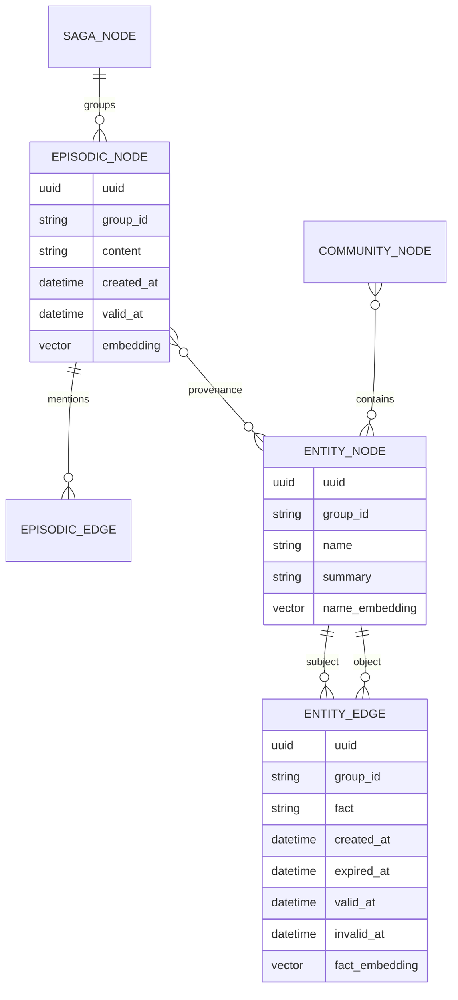
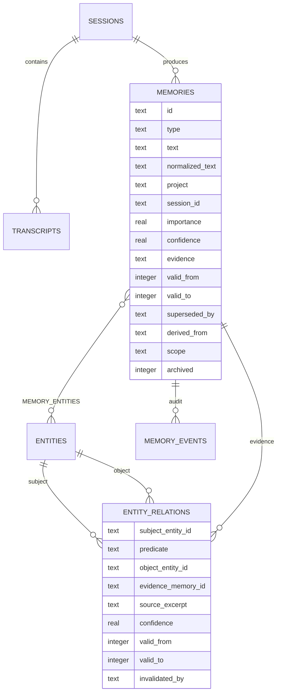

# Zep LoCoMo 94.7% audit and AstraMem comparison

Date: 2026-07-19  
AstraMem commit inspected: `277bb0644a668a751624ca45a81d2b97b30aa563`  
Public repositories inspected: `getzep/zep@0375d7b`, `getzep/graphiti@0b4bcf1`,
`getzep/zep-papers@4b7f26c`, `snap-research/locomo@3eb6f2c`.

## Executive conclusion

Zep's current claim is **94.7% LLM-judged answer accuracy (1,459 / 1,540)**
on LoCoMo categories 1-4, not token-overlap F1 and not retrieval recall. It is
not the 94.8% DMR result from Zep's 2025 paper. The current run uses GPT-5.4
with medium reasoning as both reader and chain-of-thought judge, and retrieves
five scopes in parallel: 20 edges, 10 nodes, 10 episodes, 5 thread summaries,
and 5 observations, all cross-encoder reranked. Zep reports median context of
5,760 tokens and retrieval p50/p95 of 87/155 ms.

The headline is **partly substantiated but not independently reproducible from
public code**. Zep publishes the counts, category breakdown, reader/judge, and
retrieval depths on its research page. However, the five-scope implementation,
the exact reader and judge prompts, ingestion/extraction model settings,
cross-encoder identity, observation/thread-summary construction, database
schema, and per-question artifacts for this 94.7% run are not public. These
missing pieces are material.

The public `getzep/zep` LoCoMo harness is a different, older two-scope test. Its
committed 10-run artifacts top out at **80.318% mean accuracy** using GPT-4o-mini,
30 edges + 30 nodes, cross-encoder reranking, and roughly 1,997 context tokens.
The repository's current default config is 15 edges + 5 nodes and also cannot
produce the advertised five-scope context. Do not treat the public Graphiti or
Zep harness as a recipe for 94.7%.

AstraMem's latest claimable full-suite score in-repo is **0.4610 token F1 over
all 1,986 questions**, including adversarial category 5. That is not directly
comparable to Zep's 94.7% binary LLM-judge accuracy over 1,540 category 1-4
questions. AstraMem's more recent one-conversation results (0.573-0.584 F1,
n=199) are exploratory and statistically underpowered. The first priority is a
metric-matched evaluation, followed by extraction completeness and a Zep-like
multi-scope retrieval ablation.

## Score provenance and metric splits

| Claim | Dataset/questions | Metric | Reader/judge | Status |
|---|---:|---|---|---|
| Zep 94.7% (current) | 1,540, categories 1-4 | Binary LLM-judge answer accuracy | GPT-5.4 medium / GPT-5.4 CoT | Published methodology, artifacts/code incomplete |
| Zep 86.5% auto search | same stated LoCoMo lane | Binary LLM-judge accuracy | GPT-5.4 medium / GPT-5.4 CoT | One-call, 10,000-character context; artifacts incomplete |
| Public Zep harness best | 1,540, categories 1-4 | Binary GPT-4o-mini judge accuracy | GPT-4o-mini / GPT-4o-mini, temp 0 | Reproducible code + ten committed result files; requires Zep Cloud |
| Zep 75.14% corrected 2025 result | categories 1-4 | LLM-judge accuracy | older pipeline | Zep's correction after denominator dispute |
| Zep 94.8% paper result | DMR, not LoCoMo | DMR accuracy | paper-specific | Frequently confused with LoCoMo; unrelated benchmark |
| AstraMem 0.4610 | 1,986, categories 1-5 | Porter-stemmed token F1 | Azure GPT-5-mini answerer | Full-suite, single run |

Zep's current category counts sum to 1,539 (670 + 325 + 323 + 221), while its
headline says 1,459/1,540. This one-question discrepancy is not explained on
the published page and should be treated as an unresolved reporting defect.

Sources: [Zep research methodology and results](https://www.getzep.com/research/),
[Zep retrieval philosophy](https://help.getzep.com/retrieval-philosophy),
[Zep paper (DMR result)](https://arxiv.org/abs/2501.13956), and the
[2025 methodology dispute and Zep correction](https://github.com/getzep/zep-papers/issues/5).

## Zep pipeline: what is public

| Stage | Implementation/settings | Evidence status |
|---|---|---|
| Ingest | One graph per LoCoMo conversation/user; up to 35 sessions; public harness ingestion concurrency 5 | Confirmed for public harness |
| Episode storage | Raw message/session episodes, with reference/valid time and ingestion/created time; provenance edges connect episodes to entities/facts | Confirmed in Graphiti |
| Extraction | LLM extracts entities and relationship facts, resolves entities, deduplicates facts, extracts temporal validity, invalidates contradicted facts, updates entity summaries | Confirmed algorithm; benchmark model/prompts unknown |
| Graph model | Entity, Episodic, Community, Saga and related nodes; entity facts are edges with `created_at`, `expired_at`, `valid_at`, `invalid_at`; `group_id` is the isolation key | Confirmed in Graphiti OSS; Zep Cloud extensions unknown |
| Embedding | Semantic embeddings on nodes/edges/episodes; Graphiti defaults to OpenAI clients | Confirmed generally; 94.7 model/dim unknown |
| Full-text | BM25/full-text indexes alongside vector and adjacency/CSR graph structures | Confirmed in product docs; exact engine/schema proprietary |
| Retrieval (94.7) | Five parallel searches: edges 20, nodes 10, episodes 10, thread summaries 5, observations 5 | Confirmed by research page |
| Reranking (94.7) | Cross-encoder on all five scopes | Confirmed; model, candidate depth and thresholds unknown |
| Context assembly | Client-composed multi-scope context; median 5,760 tokens | Confirmed; exact template/order/dedup unknown |
| Reader | GPT-5.4, reasoning medium | Confirmed; exact prompt/max tokens unknown |
| Judge | GPT-5.4, chain-of-thought binary grading | Confirmed; exact prompt/repeats unknown |

The current Graphiti default concurrency is `SEMAPHORE_LIMIT=10`. Its default
search recipes fuse semantic similarity, BM25 and graph-derived candidates
using reciprocal rank fusion; current OSS defaults to an OpenAI reranker
(`gpt-4.1-nano`) unless overridden. These are **Graphiti defaults, not confirmed
94.7 settings**. Graphiti supports Neo4j, FalkorDB, Neptune, and (deprecated)
Kuzu; Zep Cloud additionally describes proprietary in-memory adjacency lists,
CSR matrices, vector indexes, and BM25 indexes.

Primary code: [Graphiti repository](https://github.com/getzep/graphiti/tree/0b4bcf1284ee5fba56b77ed9961568a541e0d418),
[Zep LoCoMo benchmark](https://github.com/getzep/zep/tree/0375d7be4a72cda6a43ecdc6fd9055846eb0fd0e/benchmarks/locomo),
and [Zep's older evaluation artifacts](https://github.com/getzep/zep-papers/tree/4b7f26cc76cca20743314ba9acb8c2cb6adc42f6/kg_architecture_agent_memory/locomo_eval).

## Public Zep benchmark settings and results

The public harness skips category 5 before evaluation and runs node and edge
search concurrently. It generates an answer, then separately asks GPT-4o-mini
for a binary correctness grade and a context-completeness grade.

| Edge/node limits | Rerankers | Mean accuracy, 10 runs | Median context | Retrieval median |
|---:|---|---:|---:|---:|
| 5 / 2 | cross-encoder / cross-encoder | 69.623% | 347 tokens | 149 ms |
| 10 / 2 | cross-encoder / cross-encoder | 73.721% | 504 tokens | 161 ms |
| 15 / 5 | cross-encoder / cross-encoder | 77.058% | 756 tokens | 199 ms |
| 20 / 20 | cross-encoder / cross-encoder | 80.058% | 1,378 tokens | 241 ms |
| 30 / 30 | cross-encoder / cross-encoder | **80.318%** | 1,997 tokens | 189 ms |

This sweep is useful evidence that Zep's accuracy is recall/context-depth
sensitive. It does not validate 94.7%; the advertised run adds three scopes,
uses a much stronger reader/judge, and supplies nearly three times the context.

## Storage structures

### Graphiti / public core



`group_id` scopes graphs/tenants. Facts are preserved and temporally invalidated
rather than overwritten. Episode-to-entity/fact links provide provenance. The
94.7 Zep Cloud run also retrieves observations and thread summaries, which are
not sufficiently specified in the public schema to reconstruct.

### AstraMem local



AstraMem uses SQLite, FTS5 and sqlite-vec. It has explicit sessions,
transcripts, atomic memories, entity links, temporal entity relations, append-
style memory events, consolidation proposals, provenance/evidence, retention,
sync and numerous guard/audit tables. `project`/`repo`/`agent`/`scope` provide
local isolation and filtering. The core schema is visible in
`migrations/017-widen-memory-types.sql` and `migrations/027-entity-relations.sql`.

## Normalized comparison

| Capability | Zep 94.7 lane | AstraMem current | Likely impact |
|---|---|---|---|
| Metric | Binary GPT-5.4 LLM judge, cat. 1-4 | Token F1, cat. 1-5; optional LLM judge | Headline numbers cannot be compared |
| Reader | GPT-5.4 medium | GPT-5-mini minimal, 150 tokens in full run | Large answer-generation/scoring confound |
| Stored primitives | Episodes, entities, fact edges, observations, thread summaries | Transcripts, atoms, entities, relation edges | Zep retains more queryable representations |
| Retrieval scopes | Five parallel scopes | One fused memory/atom result list | Likely largest architectural retrieval gap |
| Retrieval depth | 50 total returned objects before composition | k=10 | Recall/context ceiling gap |
| Context | 5,760-token median | Ten atom texts; much smaller | Zep lets the reader recover from imperfect ranking |
| Reranking | Cross-encoder every scope | Cross-encoder off by default/mock | Material ranking gap, but local diagnostics say extraction is often binding |
| Multi-hop | Graph/entity/episode scopes | Decomposer off; graph relations exist but are not the main recall path | Untested AstraMem lever |
| Temporal | Fact validity plus event times and temporal reader instructions | `valid_from/to`, grounded dates; no LoCoMo `as_of` | Schema is present; extraction/rendering remain weaker |
| Extraction | Proprietary Zep settings unknown | Dual-pass available; conversational profile used in eval | 36-47% of sampled single-hop gold facts reportedly absent from store |
| Reproducibility | Partial | Strong run manifests/hash guards; insufficient repeated full runs | AstraMem is more auditable, Zep headline more capable |

Current AstraMem defaults at the inspected commit are: Codex subscription
GPT-5.4-mini for compaction and extraction; ONNX quantized
`mxbai-embed-large`, CLS pooling; SQLite-vec; fusion weights alpha/beta 0.4,
gamma/delta/epsilon 0.1, zeta/eta/theta 0; query rewrite off; cross-encoder off;
multi-hop off; recall pack off; dual-pass extraction; 3,200-character chunks;
pipeline concurrency 2. The LoCoMo full-suite run instead pinned the
conversational extraction profile, Codex GPT-5.4-mini extraction, Qwen3:8b
compaction, k=10 and GPT-5-mini answering.

## Gap analysis and experiments

| Priority | Hypothesis / experiment | Expected impact | Confidence | Effort |
|---|---|---:|---:|---:|
| P0 | Add a metric-matched categories 1-4 GPT-5.4 reader + GPT-5.4 binary judge lane while retaining token F1 | Establishes the real gap; may lift headline substantially without changing memory | High | Medium |
| P0 | Run the existing extraction/retrieval/reader oracle factorial on all conversations | Correctly attributes losses before architecture work | High | Medium |
| P1 | Fix conversational extraction completeness, especially single-hop facts; test atom-triage/repair dual pass | Largest locally measured bottleneck | High | Medium |
| P1 | Return parallel atoms + entities + source transcript episodes + relation facts + summaries, with per-scope quotas | Closest test of Zep's five-scope advantage | High | High |
| P1 | Sweep total context at 10/20/40/50 items or 1.5k/3k/5.8k tokens using a strong reranker | Public Zep sweep shows monotonic gains through larger contexts | Medium-high | Medium |
| P1 | Replace mock/off cross-encoder with a real local or hosted reranker and measure recall@k plus final accuracy | Direct parity gap | Medium-high | Medium |
| P2 | Enable existing multi-hop decomposition in a same-day A/B | Feature has not been measured on the archived baseline | Medium | Low |
| P2 | Render temporal provenance explicitly: event time, assertion time, invalidation, source excerpt | Matches Zep's temporal prompt contract | Medium | Medium |
| P3 | Add observation/pattern memories and rolling thread summaries only after oracle evidence | Potentially reproduces missing Zep scopes; risks benchmark overfitting | Low-medium | High |

Do not start by copying Graphiti's database. AstraMem already has entities,
temporal relation edges, provenance and hybrid vector/FTS storage. The measured
gap is that facts are not always extracted and those alternate representations
are not jointly retrieved into a sufficiently rich context.

## Fair reproduction commands

AstraMem's currently documented full-suite F1 baseline:

```powershell
bun scripts/eval/locomo/run.mts --dataset .eval-data/locomo/locomo10.json `
  --extract-profile conversational `
  --extraction-provider codex-subscription --extraction-model gpt-5.4-mini `
  --compaction-provider ollama --compaction-model qwen3:8b `
  --distill-timeout-ms 5400000 --k 10 --seed 42

bun scripts/eval/locomo/judge.mts --hyp <run>/hypotheses.jsonl `
  --ref <run>/sample.json --llm-judge
```

Run at least three full independent runs, archive per-question output, and
report categories 1-4 separately from category 5. A paid Zep Cloud account and
OpenAI access are required to execute Zep's public harness; its documented
entry point is `benchmarks/locomo/benchmark.py`. Exact reproduction of 94.7%
is presently impossible because the public harness lacks observations/thread
summaries and the published methodology lacks exact prompts and internal
pipeline configuration.

## Unknowns that block exact 94.7 reproduction

- Exact Zep Cloud ingestion, extraction, entity-resolution and temporal prompts.
- LLM and temperature used to build the benchmark graphs.
- Embedding and cross-encoder models, dimensions, candidate pool and thresholds.
- Observation extraction semantics and thread-summary construction/update rules.
- Context ordering, deduplication, token packing and the exact reader prompt.
- Judge prompt, structured-output contract, number of grading repetitions, and
  whether the reported value is one run or an aggregate.
- Dataset hash/version and the reason category counts total 1,539, not 1,540.
- Per-question predictions, retrieved contexts, grades and failure artifacts.
- Production Zep database schema and indexes beyond the public conceptual model.

## What AstraMem should test next

First run a **metric-matched, full-suite categories 1-4 baseline** with the same
GPT-5.4 medium reader/judge class and both F1 and binary accuracy reported. In
parallel within that run, persist an oracle breakdown for `not extracted`,
`extracted but not retrieved`, `retrieved but not answered`, and `judge/F1
disagreement`. Then perform one controlled retrieval A/B: current k=10 atom
context versus a 5,760-token multi-scope context containing atoms, entities,
source transcript episodes, relation facts and summaries. This single design
will reveal whether the path to Zep-like accuracy is chiefly stronger scoring,
extraction completeness, or richer retrieval—and prevents spending weeks on a
graph rewrite that the evidence may not support.

## Update 2026-07-20 — overnight evidence strengthens P0/P1, and the answer to "change tools"

**New data (conv-1, git-tracked):** a fresh baseline scored **0.5112** token-F1 (−6pt vs the
0.573-0.584 board → live confirmation of the ±6pt codex day-variance). A free precision-vs-recall
analysis of every answer settles the single-hop diagnosis this audit's P1 targets:

| category | precision | recall | verbose (hiR,loP) | **recall-miss (loR)** |
|---|---|---|---|---|
| single-hop | 0.423 | 0.481 | **4%** | **51%** |
| multi-hop | 0.280 | 0.366 | 3% | 56% |

The failure mode is **recall-miss, not verbose-penalty** — empirically confirming this audit's
"36-47% of gold facts absent from store" claim and the **P1 extraction-completeness** priority.
It also sharpens **P0 metric-match**: an unknown fraction of the 51% "misses" are semantically-
correct answers that token-F1 zeroes but `--llm-judge` would pass — so the LLM-judge lane is
expected to lift our comparable number materially before any architecture work.

**Answer to "can we change tools to improve?" — no stack swap needed; it's metric + retrieval-depth
+ extraction, all buildable on primitives we already have:**
1. **Metric (P0, zero new tooling):** `--llm-judge` on categories 1-4. The harness already has it;
   token-F1 is "harsher than upstream" (methodology doc) and is the single biggest apples-to-apples gap.
2. **Retrieval scope/depth (the "largest architectural gap" in the table above):** Zep fuses FIVE
   scopes (edges/nodes/episodes/summaries/observations, ~50 objects, 5,760-token context, cross-encoder
   reranked); we return one fused atom list at k=10. **We already have the tables for a multi-scope pack:**
   `MEMORIES` (facts) + `ENTITY_RELATIONS` (subject/object edges, bitemporal) + source turns (episodes/
   provenance). Building a Zep-shaped multi-scope retrieval is a search-layer change on existing storage,
   not a graph-DB adoption. Zep's own public sweep proves accuracy scales with context depth (69.6%→80.3%
   as context 347→1997 tokens).
3. **Cross-encoder ON (P1):** we ship it OFF/mock; Zep reranks every scope. Flip + measure.
4. **Extraction completeness (P1, the binding constraint):** repair-only atom triage (measured recall
   78→80.1 / typeAcc +9, currently disabled).
5. **Stronger reader** (Zep uses GPT-5.4 medium vs our fixed gpt-5-mini/minimal) lifts a *comparable*
   number but breaks the harness's "measure memory not the LLM" design — do it only for a headline claim,
   not for internal attribution.

**Not the lever:** a Neo4j/FalkorDB/graph-DB swap. The public Graphiti config tops at 80.3%, not 94.7%,
and WS3 already rejected entity-graph *traversal* on latency. The 94.7% comes from metric + multi-scope
depth + strong reader, which our existing sqlite-vec + entity_relations + cross-encoder can approximate.
